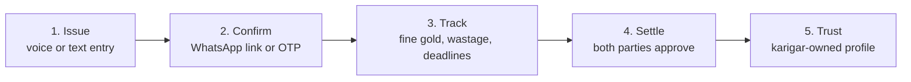
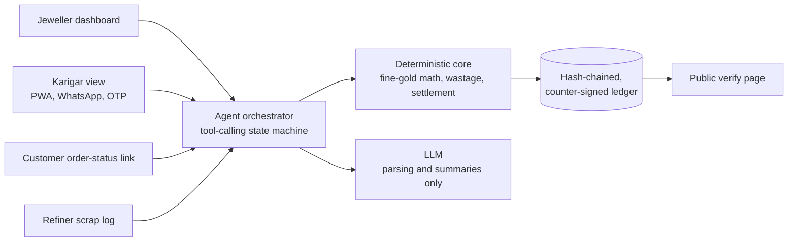
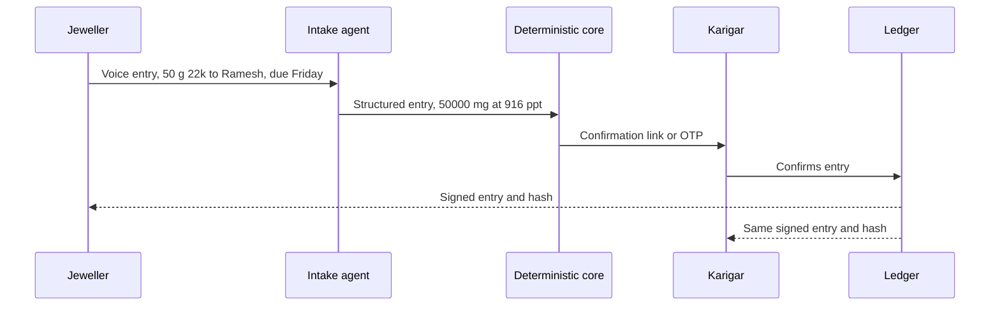
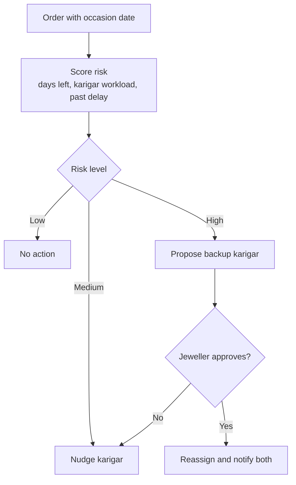
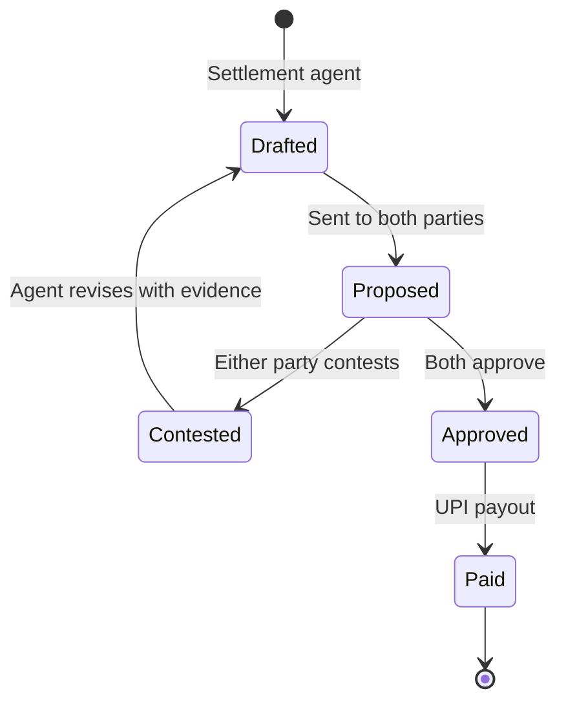
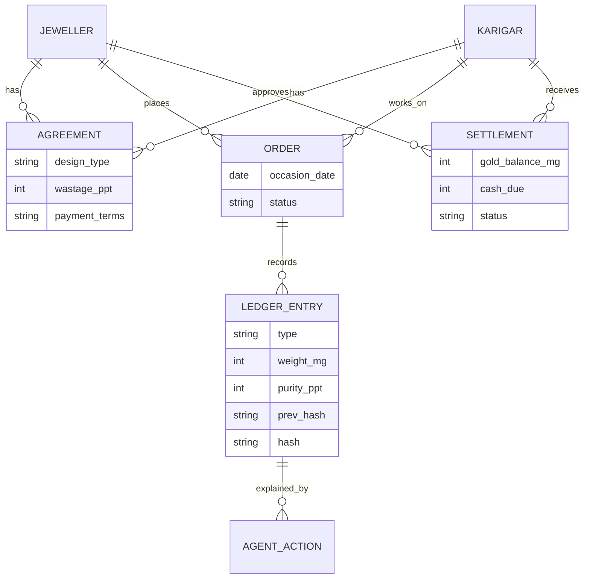
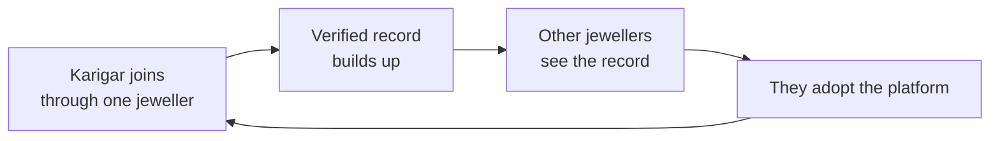
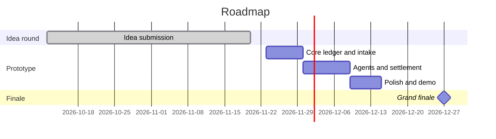

<div align="center">

# 🪙 KarigarTrust

### An agentic, two-sided gold ledger for karigar job-work

*Issue, return, wastage, deadlines and settlement, verified by both parties, with a portable trust profile owned by every karigar.*


</div>

---

## 🎯 The problem

Jewellers issue gold to artisan goldsmiths (karigars) by weight and receive finished pieces back with an agreed wastage. Today:

- 📒 Issues are written in a notebook or on a slip, held by one side.
- 🗣️ Wastage is agreed verbally, so the two sides' numbers differ when accounts are squared.
- 📞 Deadlines are chased by phone, so orders for weddings and festivals slip without warning.
- ⏳ Karigars wait weeks to be paid and cannot prove a clean delivery record to anyone.

The result is unexplained gold loss, disputes that sour long relationships, missed occasion dates and late payment to the weaker party, the artisan.

**Who is affected:** jewellers and counter staff, karigars and their helpers, customers with fixed occasion dates, and refiners who recover gold from workshop scrap.

## 💡 Our solution

One shared record, from the first gram issued to the final settlement.



### Design rules from the problem brief

- ✅ Settlements always go to **both parties** for approval. Agents propose and never finalise alone.
- 🔓 Each karigar has **full access to his own account**.
- ⚖️ Fairness matters most to the artisan. Every agent action shows its reasoning and can be contested.

## 🤖 Agents

| Agent | Acts autonomously | Human gate |
|---|---|---|
| **Intake** | Parses voice or text into structured issue and return records | Karigar confirms |
| **Fine-gold reconciler** | Converts all metal to 24k equivalent, tracks balance per karigar and per order | None (deterministic) |
| **Wastage** | Compares actual loss with the agreed rate per design type, flags the excess | Both parties on the disputed part |
| **Deadline** | Scores each order's risk against the occasion date, nudges the karigar, proposes a backup karigar | Jeweller approves reassignment |
| **Settlement** | Drafts month-end gold and cash settlement, tracks days since delivery | Both parties approve |
| **Dispute** | Builds a neutral timeline and plain-language summary from the ledger | Both parties see the same version |
| **Trust profile** | Computes on-time rate, wastage against agreement and payment delay | Karigar controls sharing |

## 🏗️ Architecture



**Principle: deterministic core, LLM at the edges.** The language model only parses speech or text and writes summaries. All balances, wastage checks and settlements are plain, testable code.

### Issue and confirm flow



### Deadline agent



### Settlement lifecycle



## 🔐 Technical approach

### Exact gold arithmetic

Weights are stored as integer milligrams and purity as integer parts per thousand. No floating point is used.

```
fine_mg = weight_mg x purity_ppt / 1000
```

Worked example:

| Event | Weight | Purity | Fine gold |
|---|---|---|---|
| Issue to karigar | 50,000 mg | 916 (22k) | 45,800 mg |
| Scrap returned | 2,000 mg | 750 (18k) | 1,500 mg |

With an agreed wastage of 3% of fine gold issued, the allowed loss is 1,374 mg. Any loss beyond that is flagged as disputed and sent to both parties.

Planned property tests: issue then full return never creates or loses fine gold, and balances are identical regardless of the order entries are processed in.

### Tamper-evident ledger

- Append-only entries. Each entry hash is `SHA-256(previous_hash || canonical_entry)`.
- Each entry is counter-signed by both parties through OTP or link confirmation.
- A public verify page recomputes the chain so either side, or a third party, can check a statement.

### Agent guardrails

- Agents act only through a fixed set of tools inside a state machine.
- Agents cannot finalise a settlement, edit confirmed entries or change a wastage agreement.
- Every agent action is logged with its inputs and reasoning, and the karigar can contest it.

### Evaluation plan

- A test set of about 100 Hindi, Marathi and Hinglish entries (for example "pachas gram bais carat Ramesh ko") covering weights, purity, karigar names and due dates.
- Metrics: field-level parsing accuracy and the share of entries needing human correction.
- Reconciliation tested on scripted multi-order, multi-karigar scenarios with mixed purities.

## 🗂️ Data model (planned)



## 📈 Business potential

- 👷 **Users.** Karigars use it free. Jewellers with roughly 5 to 30 karigars pay a monthly subscription (price to be validated in field interviews).
- 🔁 **Network effect.** One karigar works for several jewellers. His verified record at one shop pulls the next shop onto the platform.
- 🧭 **Go-to-market.** Pilot in one Pune sarafa cluster through local associations and WhatsApp onboarding, then Kolhapur, Sangli, Rajkot, Kolkata and Jaipur.



**Revenue ladder**

1. Jeweller subscription.
2. UPI settlement fees on month-end payouts.
3. Refiner integration for scrap-to-fine-gold tracking.
4. Wastage benchmarking across karigars.
5. Consent-based trust data for lenders offering working capital.

## 🆚 Differentiation

Jewellery ERPs typically cover shop billing, stock and basic karigar ledgers maintained by one side. KarigarTrust adds:

- Two-sided, counter-signed records that both parties accept.
- Autonomous deadline and settlement agents with human approval gates.
- A refiner loop that feeds recovered fine gold back into wastage reconciliation.
- A karigar-owned, portable trust profile.

## 🛡️ Compliance and risks

- **Privacy.** The trust profile is shared only with the karigar's consent, in line with India's Digital Personal Data Protection Act, 2023.
- **Regulatory fit.** The product works alongside GST job-work and HUID stock records and does not replace them.
- **Adoption.** Jewellers may resist transparency. The pitch is fewer disputes and less unexplained gold loss.
- **Language and literacy.** Voice-first entry and WhatsApp-based confirmation keep the karigar's side simple.

## 🗺️ Roadmap



**Field validation (alongside the prototype):** interviews with jewellers and karigars on how gold is issued and recorded, how wastage is agreed and disputed, payment delay, what happens when numbers differ, and typical karigar and open-order counts.

**Pilot:** 2 to 3 shops in one cluster, measuring disputes and gold variance.

## 📚 References

Verify each link before relying on it.

- Digital Personal Data Protection Act, 2023: https://www.meity.gov.in
- Gem and Jewellery Export Promotion Council (industry data): https://gjepc.org
- Bureau of Indian Standards, hallmarking and HUID: https://www.bis.gov.in
- GST job-work provisions: https://www.gst.gov.in

<div align="center">

*This repository currently documents the design. Code, tests and the evaluation set will be added during the prototype round.*

</div>
